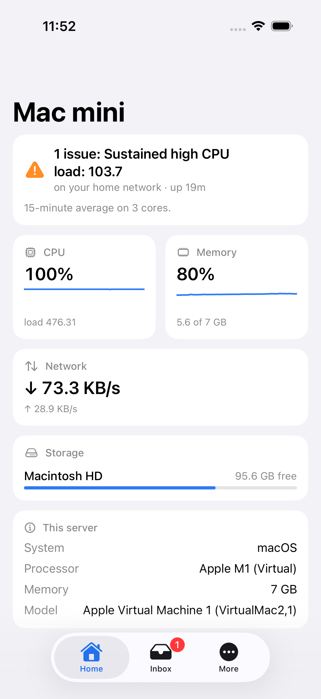
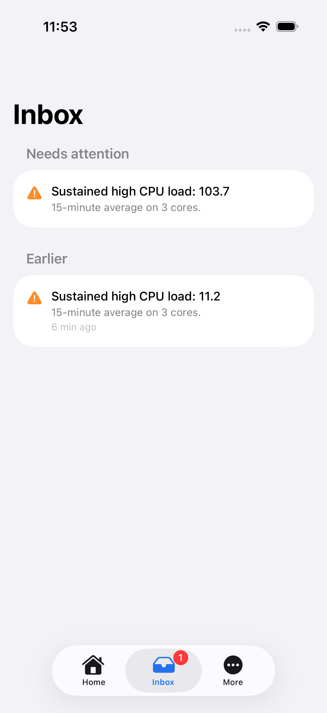
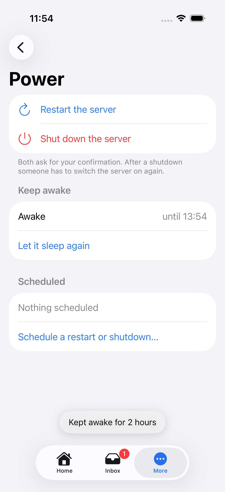
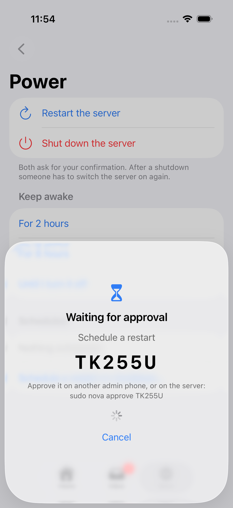

# Nova for iPhone and iPad

A native app (SwiftUI) that pairs with a Nova server the same way the Android app does and speaks the same signed
`/api/v1` — so it works with a Linux, Windows or Mac server unchanged. The source is in [`ios/`](../ios).

> **Status: preview.** It covers the everyday pages; the rest is in Nova web for now (see *What it does*). It isn't on
> the App Store yet — that needs an Apple Developer account and a review — so today it's installed by sideloading
> or by building it yourself.

<p>




</p>

## Get it

**Sideload the build from a release.** Each release carries `nova-ios.ipa`, an unsigned build. Install it with a tool
that signs apps with your own Apple ID — [AltStore](https://altstore.io), [SideStore](https://sidestore.io) or
[Sideloadly](https://sideloadly.io). With a free Apple ID the app has to be refreshed every 7 days (those tools do
it for you); with a paid developer account, once a year.

**Or build it.** On a Mac with Xcode 16 or newer:

```sh
brew install xcodegen
cd ios && xcodegen          # makes Nova.xcodeproj from project.yml
open Nova.xcodeproj         # pick your team under Signing & Capabilities, then Run on your iPhone
```

It needs iOS 16 or newer (iPhone 8 and later).

**Have an iPhone and a Windows PC?** [PREVIEWS.md](PREVIEWS.md) walks through sideloading from Windows and what's worth
trying — the app has only ever run in Apple's Simulator, so a report from a real iPhone is worth a lot.

## Pairing

On the server, open **Nova Server → Pair a phone** (or run `sudo nova add`) and scan the code with the app. Without
a camera to hand, type the server's address and the code instead: the app then shows the first letters of the
server's certificate for you to compare with what the server shows — the same check the Android app does. Away from
home, paste the setup code from `sudo nova add --remote`.

## What it does

| | |
|---|---|
| Home: status, what needs attention, live CPU / memory / network with small graphs, storage, containers, about the server | ✅ |
| Inbox: active alerts (ignore), history (archive), requests waiting for your approval (approve / decline) | ✅ |
| Containers: by stack, state, start / stop / restart, log | ✅ |
| Power: restart, shut down, schedule either, keep awake | ✅ |
| Task manager: processes by processor or memory, end / force stop | ✅ |
| Drives: space and health | ✅ |
| Users & devices: list, remove | ✅ |
| Reaching the server at home, over Tailscale, or through Cloudflare — whichever answers | ✅ |
| Alerts as notifications while the app is closed | ❌ — iOS only allows that through Apple's push service, which needs the App Store setup |
| Storage setup, backups, the app store, updates, files, terminal, lighting, the assistant, several servers | ❌ — use Nova web (your server's address in Safari; it can be added to the Home Screen) |

## How it keeps the server safe

The model is the Android app's, with Apple's parts:

- **The device key** — P-256, made in the **Secure Enclave**, where it can sign but never be copied out. Every request
  carries this iPhone's id, the time, a one-time number and a signature over all of it (`Core/API.swift`). The server
  only knows the public half, from pairing.
- **The confirmation key** — a second Secure Enclave key that only signs after **Face ID, Touch ID or the passcode**.
  Risky actions (restart, stop a container, remove a device, approve a browser…) are signed by both. It's registered
  with the server by itself on the home network or over Tailscale; from anywhere else it's a button in Settings and the
  server asks for an approval first — so a stolen, unlocked phone away from home can't give itself one.
- **The server's certificate is pinned.** On the home network and over Tailscale the server uses its own certificate;
  the app accepts exactly the one whose fingerprint it got when pairing, and nothing else. The Cloudflare address has
  an ordinary certificate, checked the ordinary way.
- The pairing (addresses, the Cloudflare service token) is kept in the Keychain, on this device only.

On the Simulator there's no Secure Enclave, so there (and only there) the keys are ordinary ones in the Keychain.

## How it's tested

`.github/workflows/ios.yml` builds the app on every change, runs its unit tests (reading pairing codes, and a signature
the server's own check accepts), then installs a Nova server on the same Mac and walks the app through it in the
Simulator: pair, Home, Inbox, drives, the task manager, devices, keep awake, schedule and cancel a restart, Settings —
keeping a picture of every page. It also builds the unsigned `.ipa`.

Not tested there: a real iPhone's Secure Enclave and Face ID prompt, the camera scanning a code, and the local-network
permission prompt — the Simulator has none of them.
